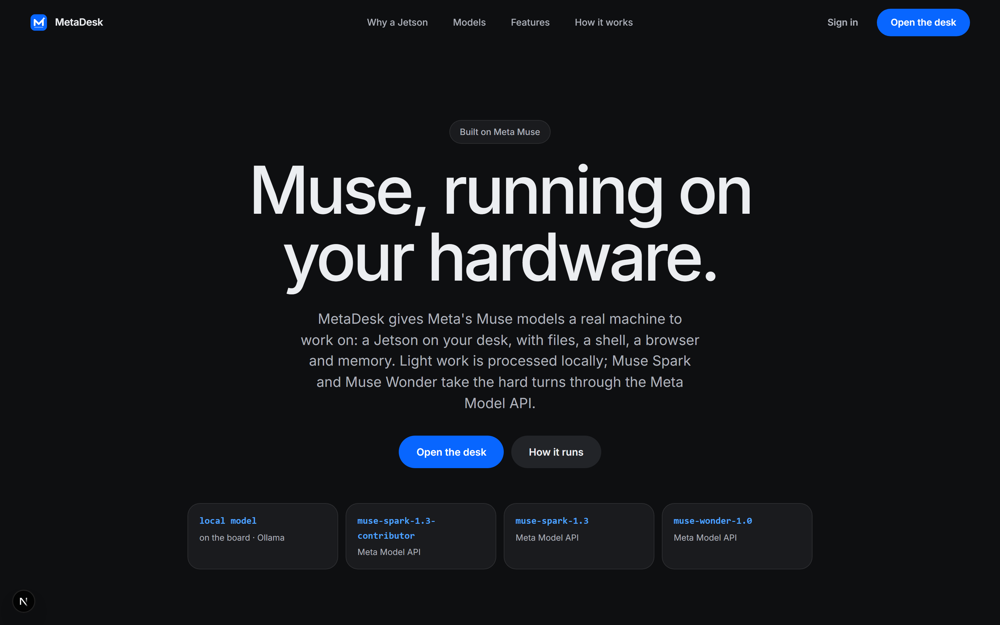
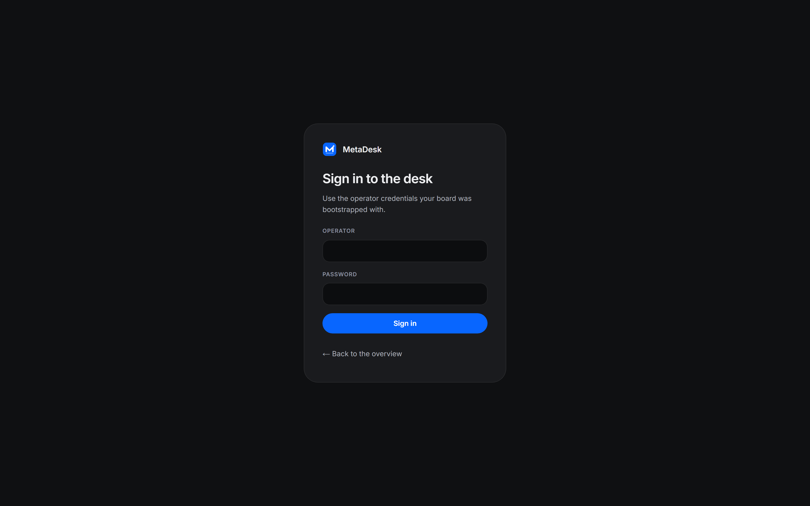
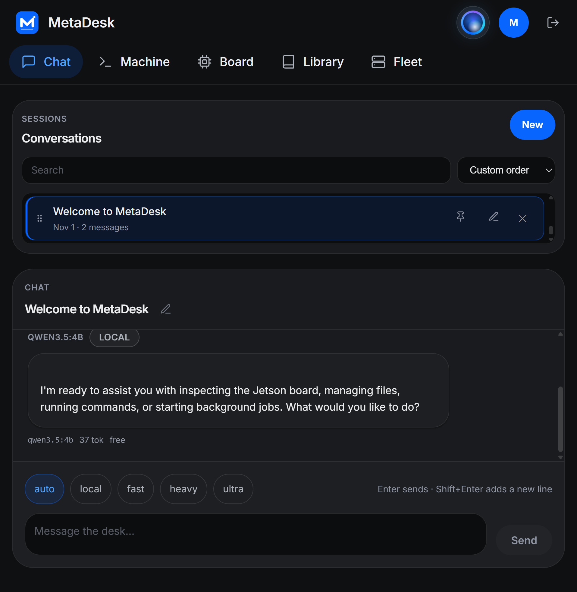
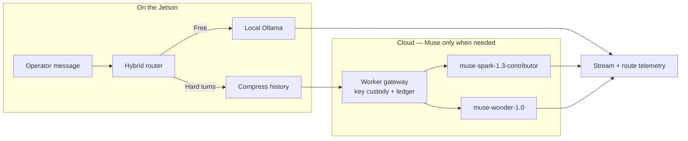
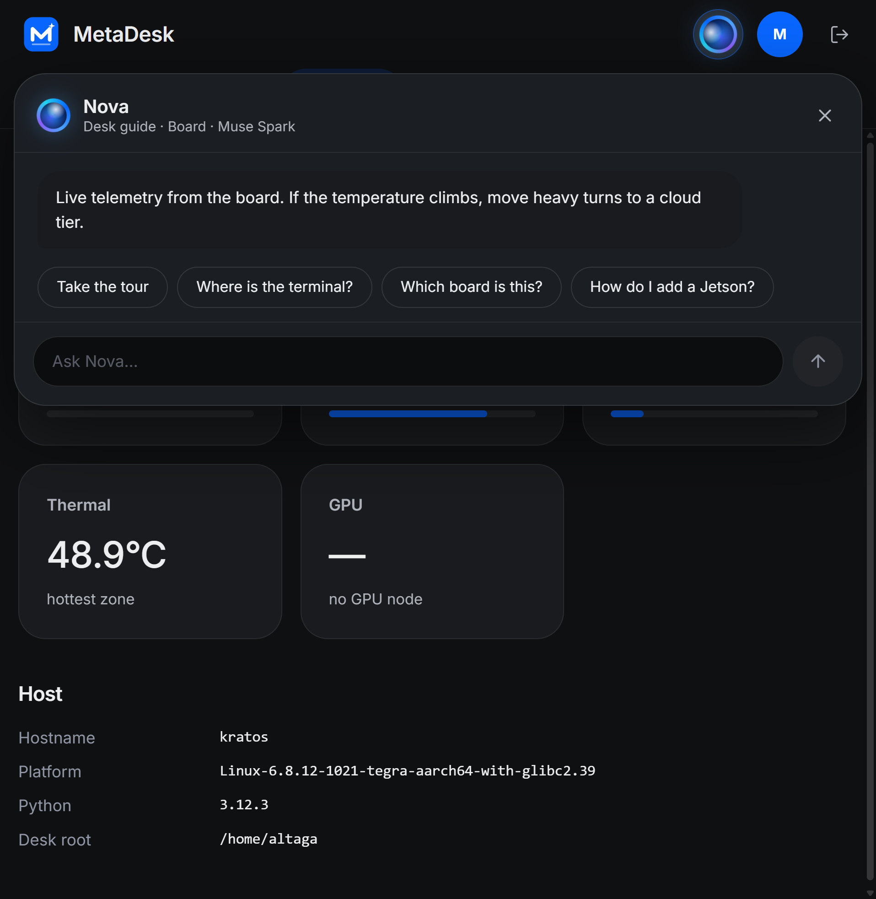
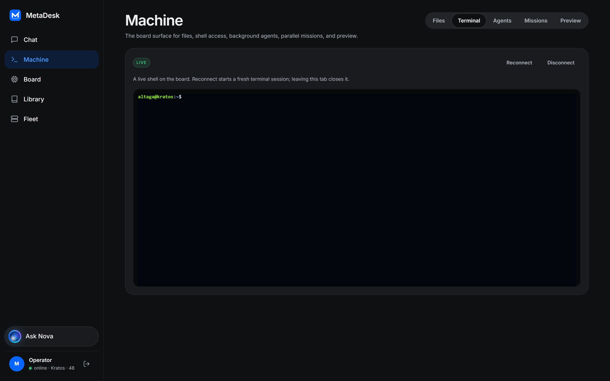
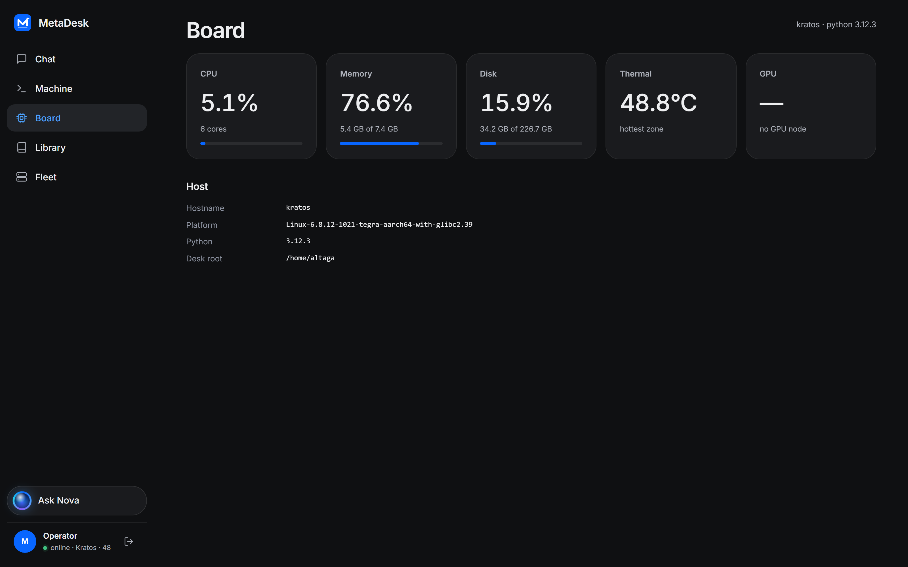
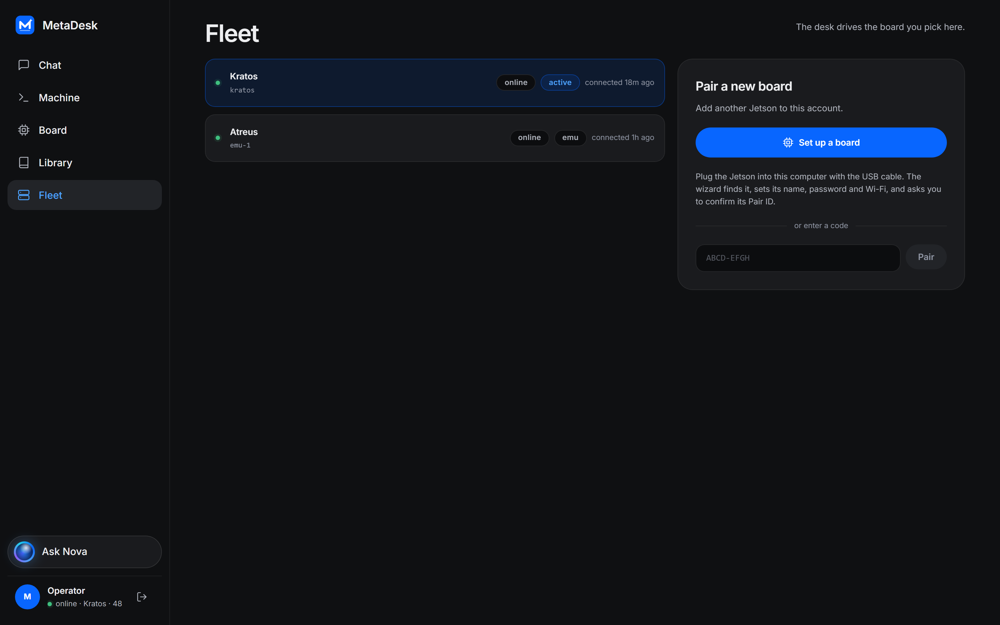
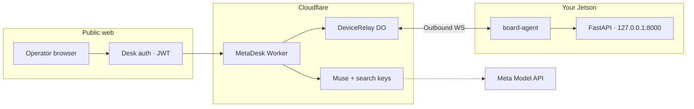

<p align="center">
  
</p>

<h1 align="center">MetaDesk</h1>

<p align="center">
  <strong>Muse, running on your hardware.</strong><br>
  An operator desk that gives Meta&apos;s Muse models a real NVIDIA Jetson to work on —
  shell, files, browser, and background jobs on the board you own.
</p>

<p align="center">
  <a href="#the-desk"></a>
  <a href="#the-muse-ladder"></a>
  <a href="#security"></a>
  <a href="./LICENSE"></a>
</p>



---

## What it is

Most chat apps rent a model in a data center and leave your hardware idle. MetaDesk flips that:

1. **Muse is the brain.** Hard turns go to Meta&apos;s Muse models (`muse-spark-1.3-contributor`, `muse-spark-1.3`, `muse-wonder-1.0`) through the Meta Model API — keys stay in the Cloudflare Worker, never on the board or in the browser.
2. **The Jetson is the body.** Chat drives a real PTY, the desk workspace, a headless browser, and durable jobs **on the board**.
3. **Local processing is the filter.** A small Ollama model on the Jetson handles routing, short answers, and prompt compression for free. Muse is called when a turn needs it.
4. **No inbound ports.** The board dials out to a Cloudflare Durable Object relay, so it works behind home or lab NAT.

---

## Signing in

Operators sign in once with the credentials the board was bootstrapped with and land on the desk.



---

## The desk

One surface for the whole machine: conversations on the left, live Muse / local routing in the composer, and the board itself — Machine, Board telemetry, Library, Fleet — one click away.



The model sees real observations from the box, not a mock. Destructive shell, patches, and deploys wait for your approval.

---

## The Muse ladder

Every turn picks a rung before it costs anything. Leave the composer on **Auto**, or pin a tier by hand:

| Tier | Engine | Model | Job |
|---|---|---|---|
| **Local** | Ollama on the Jetson | `qwen3.5:4b` (`OLLAMA_MODEL`) | Routing, short answers, compression — free & offline |
| **Fast** | Meta Model API | `muse-spark-1.3-contributor` | Everyday coding and longer reasoning |
| **Heavy** | Meta Model API | `muse-spark-1.3` | Hard debug / deep context |
| **Ultra** | Meta Model API | `muse-wonder-1.0` | Manual / hardest turns |



`LLM_MODE`: `hybrid` (default) · `local_only` · `cloud_only`. Cloud spend is metered in D1; the board keeps a soft daily budget.

---

## Nova, the desk guide

Nova lives in the header. She is not a second board agent: she knows the product, answers in your language, and can drive the UI (open a screen, spotlight a control). She runs on **Muse Spark** in the Worker and never runs shell or writes files.



---

## Machine console

The same desk flips to the board itself — files, a live shell, agents, missions, and preview. What you see and what Muse acts on are the same device.



---

## Board telemetry

Health, host identity, and desk root come from the live device — GPU/thermals when the hardware reports them.



---

## Fleet

Pair several boards to one account and switch which one the desk drives. Pairing is dial-out only: a USB setup wizard or a short claim code — never an exposed `:8000`.



---

## What the agent can do on the board

The model asks for work with fenced blocks; the board executes them behind approval and safety gates.

| Fence | Capability | Approval |
|---|---|---|
| `run` | Shell on the board | Destructive only |
| `read` / `list` | Workspace filesystem | — |
| `patch` | Single-match code edit with diff preview | **Always** |
| `search` | Web search via the Worker gateway | — |
| `install` | Vetted recipes from trusted hosts only | Trusted hosts |
| `browse` | Headless browser + screenshots | — |
| `job` | Background work that outlives the chat tab | — |
| `deploy` | Deploy recipe with rollback on failure | **Always** |

---

## Security



- Secrets never leave the Worker; the board holds only a `device_token`.
- The board opens no inbound port for remote control.
- Unpaired `/setup` is USB-local only and shuts down after pairing.

Canonical detail: [docs/ARCHITECTURE.md](./docs/ARCHITECTURE.md) · [docs/API.md](./docs/API.md) · [AGENTS.md](./AGENTS.md).

---

## Repository layout

```
MetaDesk/
├── apps/
│   ├── api/            # FastAPI on the Jetson — hybrid router, chat tools, jobs
│   ├── web/            # Next.js desk UI + BFF
│   ├── cloud/          # Cloudflare Worker + D1 + DeviceRelay + Muse gateway
│   ├── board-agent/    # Outbound WebSocket agent
│   └── board-emu/      # Docker fake boards for local pairing / demos
├── docs/
│   ├── ARCHITECTURE.md
│   ├── API.md
│   ├── brand/
│   └── screenshots/
├── AGENTS.md
└── README.md
```

---

## Next step

MetaDesk today is a **general-purpose operator desk** for Jetson boards driven by Muse. The next leap is the same chat surface as a control plane for **robotic systems** — fleets of manipulators, rovers, and other edge machines — dispatched in natural language on top of this stack.

---

## Acknowledgements

Built for **Cerebral Valley & Meta AI**, powered by [Meta Muse](https://ai.meta.com/), [NVIDIA Jetson](https://www.nvidia.com/en-us/autonomous-machines/embedded-systems/), [Cloudflare Workers](https://workers.cloudflare.com/), and [Ollama](https://ollama.ai/).

## License

MIT — see [LICENSE](./LICENSE).
