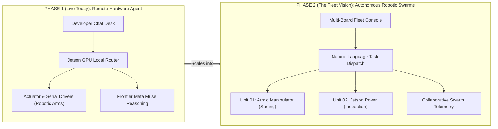
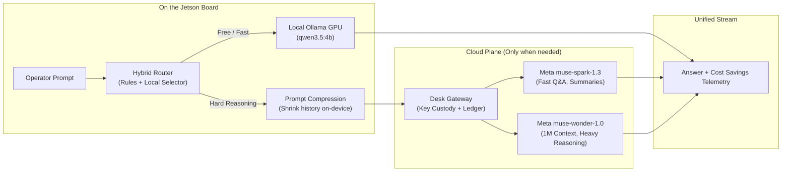
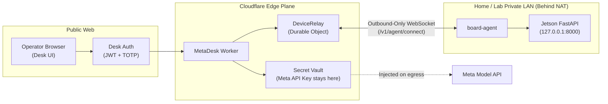

<p align="center">
  
</p>

<h1 align="center">MetaDesk</h1>

<p align="center">
  <strong>Talk to Edge Hardware. Command Robot Fleets.</strong><br>
  An embodied AI operator desk whose brain lives on physical edge hardware — transforming NVIDIA Jetsons into chat-driven robotic swarms.
</p>

<p align="center">
  <a href="#the-10-second-tldr"></a>
  <a href="#the-model-ladder"></a>
  <a href="#hybrid-edge-cloud-architecture"></a>
  <a href="#security--zero-inbound-ports"></a>
  <a href="#the-grand-vision-from-edge-agents-to-robot-fleets"></a>
  <a href="./LICENSE"></a>
</p>

---

## ⚡ The 10-Second TL;DR

> **Why did we build MetaDesk?**<br>
> Most AI agents live trapped in cloud data centers with no eyes, no hands, and zero physical presence. Meanwhile, millions of developer boards and robotics kits sit idling on desks.<br>
> **MetaDesk gives AI a physical body and an edge brain.**

1. **Physical Edge Brain:** The agent lives on your **NVIDIA Jetson** (with Arduino / robotic arm hardware tie-ins). It's not a generic web chatbot—it directly controls the shell, files, GPIOs, cameras, and robotic actuators.
2. **Hybrid Intelligence Ladder:** A fast local GPU model (Ollama) answers routine queries for free, inspects hardware, and compresses context on-device. When complex spatial reasoning or heavy architecture is required, it routes out to **Meta's Muse models** (`muse-spark-1.3`, `muse-wonder-1.0`).
3. **Zero-Trust Outbound Relay:** The edge device dials **out** to a Cloudflare Durable Object relay. You can control your hardware from anywhere in the world behind home or lab NAT without opening a single inbound port.
4. **The Big Vision — Robot Fleets via Chat:** Jetson is the industry standard for robotics. MetaDesk is evolving from a single developer desk into a **unified conversational control plane for fleets of autonomous robots** (manipulator arms, rovers, and edge drones).

---

## 🚀 The Grand Vision: From Edge Agents to Robot Fleets

The physical edge is where AI meets the real world. MetaDesk is intentionally architected in two complementary phases:



### Phase 1: The Remote Hardware Agent (Active Today)
* **Embodied Execution:** The model inspects real GPU thermals, disk IO, cameras, serial buses, and connected hardware.
* **Safety Fences & Human Brakes:** Hardware commands, code patches, and actuator movements pass through explicit safety gates and physical kinematic interlocks before execution.
* **Cost-Controlled Edge Inference:** The GPU on your desk becomes your cost control plane. Over 70% of routine queries, telemetry polls, and history compression run completely free on local silicon.

### Phase 2: Autonomous Robot Fleets Controllable by Chat (The Next Leap)
* **Why NVIDIA Jetson?** NVIDIA Jetson is the gold-standard compute module for autonomous machines worldwide. By building MetaDesk on Jetson, every connected board is a potential autonomous robot.
* **Conversational Fleet Dispatch:** Instead of writing low-level ROS2 nodes or manual joystick routines, operators simply talk to their fleet:
  > *"Nova, have Armic Arm Unit 01 pick and sort the microcontrollers on tray A, while Rover Unit 02 conducts an autonomous thermal sweep of Sector 4."*
* **Distributed Swarm Coordination:** The Cloudflare Durable Object relay aggregates fleet status in real-time, allowing swarms of heterogeneous edge robots to coordinate, share spatial memory, and execute multi-agent physical workflows safely.

---

## 🧠 The Hybrid Model Ladder

Most AI applications blindly beam every keystroke to expensive cloud APIs. MetaDesk treats the Jetson GPU as an **intelligent cost filter and compression engine**:



### The Tier Hierarchy

| Tier | Engine | Model | Purpose & Workload |
|---|---|---|---|
| **`local`** | Local Jetson GPU (Ollama) | `qwen3.5:4b` (`OLLAMA_MODEL`) | **100% Free & On-Device.** Greetings, intent routing, format conversion, hardware telemetry polling, and prompt history compression. |
| **`fast`** | Meta Model API | `muse-spark-1.3` | **Low Latency Cloud.** General engineering Q&A, code analysis, fast summaries, and live interactive guidance. |
| **`heavy`** | Meta Model API | `muse-wonder-1.0` | **Frontier Agentic Reasoning.** 1M-token context window, multi-file code refactors, complex kinematics planning, and deep system debugging. |
| **`ultra`** | Meta Model API | `muse-wonder-full-1.0` | **Maximum Compute.** Reserved for high-complexity architectural synthesis (manual selection only). |

Leave the router on `Auto` to let the Jetson pick the most economical capable tier per turn, or manually pin a specific tier in the desk composer.

---

## 🦾 Real Hardware Actuation: The Armic Proof-of-Concept

MetaDesk doesn't just read mock files—it physically interacts with microcontrollers and mechanical robots.

Included in the architecture is a dedicated standalone **Serial Actuator Subsystem** for 4DOF robotic arms (e.g., Arduino UNO Q + Adafruit PCA9685 PWM servos):
* **Kinematics with Physical Interlocks:** Firmware-enforced S-curve acceleration curves and strict angle boundaries (e.g., Elbow mechanically locked to $\ge 90.0^\circ$ to prevent physical gear stripping).
* **Direct Hardware Fences:** Chat commands automatically translate into validated serial packets over USB CDC (`COM8` / `/dev/ttyGS0`).
* **Emergency Stop (`ESTOP`):** Instant de-energizing of motor PWM lines via hardware override.

```
Operator Chat: "Gently pick up the component at coordinates X:120 Y:45 Z:10"
      │
      ▼
MetaDesk Hybrid Router (Validates kinematics + safety bounds)
      │
      ▼
Outbound Serial Frame: "JOINTS 90.0 110.0 95.0 45.0" -> S-Curve Servo Trajectory
```

---

## 🛠️ What the Agent Can Do on the Board

The model emits structured, fenced action blocks that run natively on the Jetson inside security containers:

| Tool Fence | Capability | Approval Gate |
|---|---|---|
| `run` | Execute shell commands on the board (secrets automatically injected, never printed) | **Destructive only** |
| `read` / `list` | Inspect workspace filesystem, configs, and directory structures | Automatic |
| `patch` | Precision single-match code edits with diff preview | **Always required** |
| `health` | Instant snapshot of Jetson GPU, RAM, thermals, and disk usage | Automatic |
| `install` | Safe package installation with verified registry checks (prevents `curl\|bash` exploits) | Vetted hosts only |
| `browse` | On-board headless browser execution with screenshot capture | Automatic |
| `record` | Record automated video walkthroughs of running web apps on the board | Automatic |
| `verify` | Execute automated test harnesses (`verify.json`) | Automatic |
| `job` | Long-running background daemon tasks that survive browser tab closure | Automatic |
| `deploy` | Atomic deployment recipes with automatic rollback on test failure | **Always required** |

---

## 👩‍🚀 Nova: Your On-Screen AI Desk Guide

<p align="center">
  <em>Nova lives in the desk sidebar. She is not a separate chat persona—she is an embodied assistant that drives the UI for you.</em>
</p>

* **Interactive Tour:** Click *Take the tour* and Nova walks you through all 7 areas of the desk (Chat, Model Ladder, Terminal, File Tree, Telemetry, Vault, and Fleet Pairing), dynamically highlighting each button and switch as she explains it.
* **Zero Cost:** The guided tour runs locally without spending a single API token.
* **Strictly Guarded:** Powered by `muse-spark-1.3`, Nova can navigate the interface and explain features, but cannot execute arbitrary shell commands or overwrite files without operator authorization.

---

## 🔒 Security: Zero Inbound Ports, Zero Leaked Keys



1. **No Inbound Ports on the Jetson:** The board initiates an **outbound** persistent WebSocket connection to the Cloudflare Durable Object relay. You never have to port-forward, configure dynamic DNS, or expose port 8000 to the public internet.
2. **Secrets Never Leave the Cloud Gateway:** The Meta Model API key resides exclusively inside Cloudflare Worker secrets. The Jetson board holds only a scoped `device_token`.
3. **Hardware Claim Code Pairing:** Pairing a new Jetson to your fleet takes 10 seconds via a 6-digit claim code over a local USB gadget link or local network handshake.

---

## 📂 Repository Layout

```
MetaDesk/
├── apps/
│   ├── api/            # FastAPI on Jetson: router, chat tools, hardware CLI, jobs
│   ├── web/            # Next.js 14 desk UI: real-time streaming, telemetry, fleet view
│   ├── cloud/          # Cloudflare Worker + D1 + Durable Object relay + Meta gateway
│   ├── board-agent/    # Outbound-WS daemon on the board proxying cloud to local API
│   └── board-emu/      # Docker-based emulated Jetson boards for instant local testing
├── docs/
│   ├── ARCHITECTURE.md # Exhaustive system architecture, routing logic & security
│   ├── API.md          # Complete REST, WebSocket & RPC contract specifications
│   └── brand/          # Vector assets and design guidelines
├── armic_serial.py     # Turnkey serial driver & CLI for 4DOF robotic arm actuators
├── AGENTS.md           # Machine-facing orientation and invariants for AI agents
└── README.md           # You are here
```

---

## ⚡ Quickstart: Try It in 3 Minutes

You don't need a physical Jetson on hand to evaluate MetaDesk! You can run our Dockerized `board-emu` immediately on your laptop:

### 1. Clone & Install Dependencies
```bash
git clone https://github.com/altaga/MetaDesk.git
cd MetaDesk

npm run install:web
npm run install:api
```

### 2. Configure Environment
```bash
cp secrets.env.example secrets.env
# Add your Cloudflare credentials or META_API_KEY if testing cloud tiers
```

### 3. Spin Up the Desk & Emulated Board
```bash
# Terminal 1: Launch Local API & Board
npm run dev:api

# Terminal 2: Launch Next.js Web Desk
npm run dev:web
```
Open **[http://localhost:3000](http://localhost:3000)** in your browser. Log in, take the guided tour with Nova, and watch the hybrid ladder route queries in real-time!

---

## 👥 Hackathon Team & Acknowledgements

Built with passion for **Cerebral Valley & Meta AI**:
* **Architecture & Edge AI:** MetaDesk Team
* **Powered by:** [Meta Muse Models](https://ai.meta.com/) (`muse-spark-1.3`, `muse-wonder-1.0`), [NVIDIA Jetson](https://www.nvidia.com/en-us/autonomous-machines/embedded-systems/), [Cloudflare Workers](https://workers.cloudflare.com/), and [Ollama](https://ollama.ai/).

---

## 📄 License

This project is licensed under the **MIT License** — see the [LICENSE](./LICENSE) file for details.
