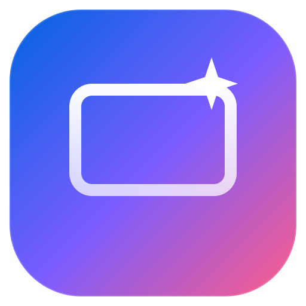
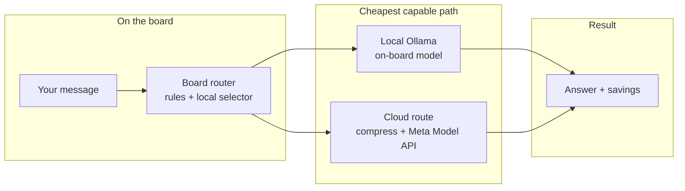
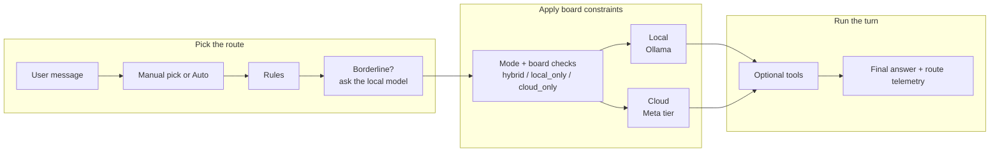
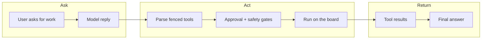
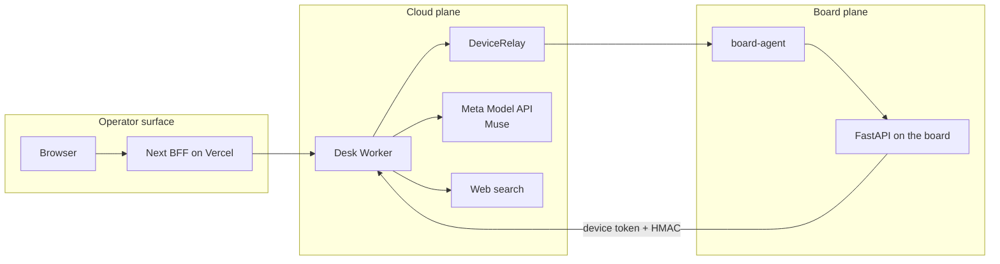
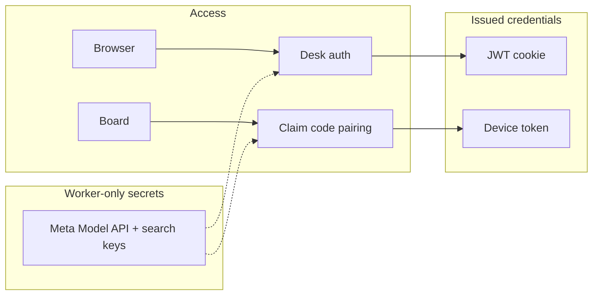

<p align="center">
  
</p>

<h1 align="center">MetaDesk</h1>

<p align="center">
  An operator desk whose brain lives on <strong>your</strong> NVIDIA Jetson.
  Chat drives the shell, files, browser, and background jobs on the box —
  light work is processed locally on the board, hard work reaches out to
  Meta's <em>Muse</em> models through the Meta Model API.
</p>

MetaDesk takes the machine you already own and turns it into the control plane for
your own agent. The desk is not a chatbot with a filesystem plugin: it is a single
surface where a model reasons about a real device, asks it for work, and shows you
what it found. The edge answers, routes, and shrinks the prompt; the cloud is rented
only after the edge admits the request.

## Signing in

Operators sign in once and land straight on their desk. The desk remembers your
boards, your last conversation, and where you left the machine — no configuration
wizard, no per-session setup.

## The desk

One surface for the whole machine: a conversation on the left, live board context on
the right, and the board itself — health, shell, files, services, agents — one click
away. The model sees real observations from the box, not a mock.

## Nova, the desk guide

Nova is the guide living in the desk's sidebar. She is not a second chatbot: she knows
the product, answers in your language, and can drive the screen for you. Ask her to open
the terminal, find the secrets, or switch boards — she navigates there and points at the
exact control she means.

New here? Press *Take the tour* and she walks you through the desk in seven steps (chat,
model tiers, the machine shell, files, telemetry, secrets, adding a Jetson), lighting up
each control as she talks. The tour runs locally and costs no tokens.

Her turns run on `muse-spark-1.3` in the Worker, and she can only ever touch an
allowlisted set of UI actions: open a screen, highlight a control, pick a board, react.
She never runs shell, never writes files, and never sends chat on your behalf.

## The one idea

Most chat apps pick one model and bill every token. MetaDesk treats the Jetson as a
**ladder**: a small local model answers free when it can, picks the cheapest capable
Meta tier when it can't, and **shrinks the prompt** before paid tokens ever leave the
board. The GPU you already own becomes the cost control plane.



Leave it on `Auto` and the router decides per turn — or pin a tier by hand from the
model picker in the composer.

## The model ladder

The ladder is what makes the desk economical. Each tier is the cheapest thing that can
still answer the turn well.

| Tier | Where | Default model | Job |
|---|---|---|---|
| `local` | Ollama on Jetson GPU | `qwen3.5:4b` (`OLLAMA_MODEL`) | greetings, translate/format, short rewrites, **routing**, **history compression** |
| `fast` | Meta Model API | `muse-spark-1.3` | everyday Q&A, code help, summaries |
| `heavy` | Meta Model API | `muse-wonder-1.0` | hard reasoning, architecture, long debug |
| `ultra` | Meta Model API | `muse-wonder-full-1.0` | manual only (composer) |

The local tier is any model Ollama can serve on the board, set with `OLLAMA_MODEL`. On an
8 GB Jetson Orin Nano the default is `qwen3.5:4b`, the best of the 3B–4B models we measured
on that board, so the free tier runs on silicon you own. `muse-wonder-1.0` is Meta's frontier agentic model with a 1M
context window; `muse-wonder-full-1.0` is the subscription-only sibling that the
headline benchmarks describe.

## How routing and web search actually work

The desk does not blindly send every turn to one big cloud model. Routing is a staged
decision that starts on the board, uses cheap rules first, and only spends cloud tokens
when the request justifies it.



In plain English:

- `manual` wins first: if you pin a tier in the composer, the router respects it.
- `rules` handle the cheap obvious cases first:
  - greetings, tiny rewrites, typos, translation, short formatting → `local`
  - normal questions and coding help → `fast`
  - architecture, hard debugging, long plans → `heavy`
- `local selector` only wakes up for borderline requests. It asks the local model for
  the cheapest tier that can still answer well.
- `overrides` then apply product constraints:
  - `local_only` never opens the Meta Model API
  - `cloud_only` bumps local requests to a cloud tier
- `compression` happens only on cloud routes: older history is shrunk on the Jetson
  before paid tokens leave the board.
- `budget checks` run before the Meta Model API: an exhausted daily cloud budget falls
  back to local when possible.

`LLM_MODE` is `hybrid` (default) · `local_only` · `cloud_only`.

### Tool selection

The model does not call internal functions directly. It asks for work by emitting fenced
blocks such as `run`, `read`, `list`, `browse`, `search`, or `job`, and the desk executes
those blocks on the board after applying approval and safety rules.



That is how the agent decides which tool to use:

- shell or machine inspection → `run`, `health`, `probe`, `verify`, `checks`
- filesystem work → `read`, `list`, `patch`
- browser work → `browse`, `record`, `render`
- background work that should survive the tab → `job`
- web research or trusted install lookups → `search`

### Web search: where it is used

Web search is the desk's fresh-context tool, not the main reasoning model. It is called
when the agent needs live results, and it matters most in two paths:

1. `search` fences
2. `install` fences, where the desk re-searches the package or tool before running it

Important behavior:

- paired boards usually call search through the desk gateway, so the key never leaves
  the Worker
- without a configured key, search returns a mock result instead of breaking the flow
- searches are capped with credits; hitting the cap returns a clear error
- repeated upstream failures open a circuit breaker and fall back to a soft mock
- `install` is stricter than `search`: it keeps only trusted hosts such as official
  registries and vendor docs, and refuses suspicious install paths

So the split is:

- **Meta Muse** answers and reasons
- **web search** fetches fresh context
- **the Jetson** decides when either one is worth using

## Why a physical Jetson is the product

- **Split-plane inference.** The edge answers, routes, and compresses; the cloud is
  rented only after the edge admits the request. Cost is a routing policy on silicon
  you own.
- **Data locality.** Desk tools run next to the board. The model sees observations, not
  a remote filesystem mount.
- **No inbound ports.** The board dials **out** to the desk relay, so it works behind
  home/lab NAT. Pairing is a short claim code, not an exposed `:8000`.
- **Real machine context.** Health, GPU, RAM, disk, per-board memory, and shell tools all
  come from the actual device — not a mock.

## What the agent can do on the board

The model asks for actions with fenced blocks; each one runs on the board (approval-gated
where it matters).

| Fence | What it does | Approval |
|---|---|---|
| `run` | Shell command on the board (vault secrets injected, never printed) | destructive only |
| `read` / `list` | Read a file / list a directory under the desk root | — |
| `patch` | Scoped single-match code edit | **always** |
| `search` | Web search (mock without a key) | — |
| `work` | Rewrite durable `.desk/WORK.md` state | — |
| `probe` | Me-vs-service network probe | — |
| `health` | GPU / RAM / temp / disk snapshot | — |
| `verify` | Run `.desk/verify.json` harness | — |
| `deploy` | Recipe → verify → rollback on failure | **always** |
| `checks` | Lint / type / vuln gate | — |
| `bakeoff` | Provider latency comparison report | — |
| `browse` | Headless browser on the board (screenshots) | — |
| `record` | Scripted demo video of a page | — |
| `render` | HTML/SVG → PNG/JPEG image | — |
| `job` | Durable background job that survives the chat | — |
| `install` | Searches official sources, trusts only vetted hosts, then installs | safe |

**Safe install** is the headline safety feature: `install` re-searches, keeps only
trusted hosts (nodejs.org, python.org, nvm-sh/nvm, npmjs.com, pypi.org, …), refuses
typosquats and `curl|bash` from unknown domains, and runs a curated recipe.

## The machine console

The same desk flips to the board itself. Every tab is wired to the live device — no
polling mock — so what the model reads and what you see are the same numbers: health,
GPU and thermals, terminal, files, services, and registered agents.

## Telemetry, memory, and plan

The right rail keeps the reasoning honest: the chat transcript, the board's shared memory
and status, and the plan the agent is working through — all in one column.

## Pairing a board

A board comes online with a short claim code, not an exposed port. The desk → cloud →
board handshake is dial-out only, so a Jetson behind a home router pairs the same way one
in a lab does.

## Architecture



Six apps, one repo:

| App | Role |
|---|---|
| `apps/api` | FastAPI on the board: router, chat tools, edge FS/CLI, jobs |
| `apps/web` | Next.js desk UI — the real product surface |
| `apps/cloud` | Worker + D1 + relay: accounts, pairing, metering, key custody |
| `apps/board-agent` | Dials out and proxies the desk cloud to the local API |
| `apps/board-emu` | Docker fake boards for demos |

## Security model



- Product login is desk-issued (short-lived JWT + refresh, optional TOTP). The browser
  never holds API keys.
- The gateway stores only the **hash** of the device token; the board holds the secret.
- Human brakes: approval cards for edits and destructive shell, no free sudo, vetted
  installs.

## Layout

```
MetaDesk/
├── apps/{api,web,cloud,board-agent,board-emu}
├── docs/                   # ARCHITECTURE.md · API.md · brand/
├── AGENTS.md               # how AI agents should work in this repo
└── README.md               # you are here
```

## Docs

- [Architecture](./docs/ARCHITECTURE.md) — apps, model ladder, Nova the guide, security, money, deploy
- [API contract](./docs/API.md) — lanes, errors, CORS, gateway HMAC, ops
- [AGENTS.md](./AGENTS.md) — the machine-facing contract for coding agents

## License

MIT — see [LICENSE](./LICENSE).
