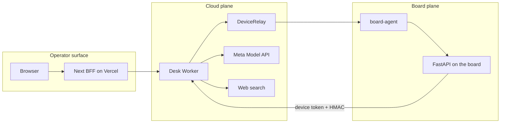
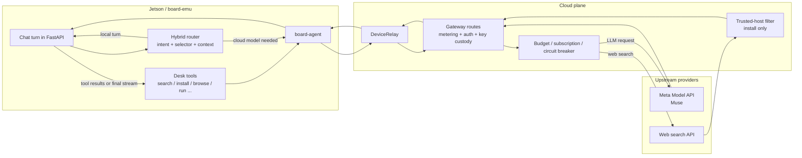
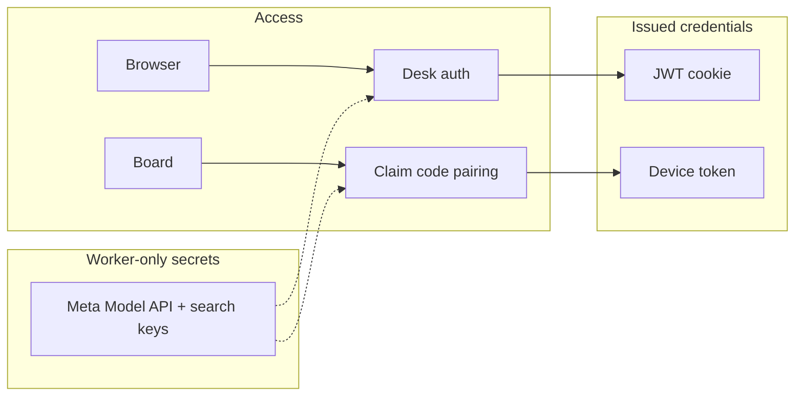

# MetaDesk — Architecture

An **operator desk** for an NVIDIA Jetson (or a Docker `board-emu`). Chat drives
shell / files / browser / jobs **on your box**. Light work is processed locally (an Ollama
model on the GPU); hard work goes to Meta's **Muse** models through the Meta Model API under a
metered cloud budget. The desk cloud owns identity, fleet, and the provider keys.

> The board is the product. Without a paired board the desk is just auth chrome.

## Apps

| App | Role | Runs on |
|---|---|---|
| `apps/api` | FastAPI on the board: auth, hybrid LLM router, chat + desk tools, edge FS/CLI, browser, jobs, vault, telemetry | Jetson / board-emu |
| `apps/web` | Next.js desk UI (the real product surface), proxies to the desk cloud via `/api/desk/*` | Vercel |
| `apps/cloud` | Cloudflare Worker + D1 + Durable Object relay: accounts, pairing, gateway metering, guide stream, ops | Cloudflare |
| `apps/board-agent` | Long-lived Python agent that dials **out** and proxies cloud → `127.0.0.1:8000` | Board |
| `apps/board-emu` | Docker fake boards. Cloud-only, no Ollama/CUDA | Docker |

## Request path



The board never opens an inbound port. It dials **out** to `/v1/agent/connect`, and
the relay proxies `/v1/devices/{id}/*` back down the same socket.

## Meta and web-search call path

This is the provider-specific path once a paired board is online. The Jetson never
talks to the Meta Model API directly with a raw provider secret. It talks to the desk
cloud first, and the cloud gateway decides how to call each upstream.



End to end, one cloud-backed turn works like this:

1. The Jetson receives the chat turn in `apps/api` and the hybrid router decides whether
   it can stay local or needs cloud help.
2. If it is a **cloud** turn, the board sends the request through the outbound relay
   path: `FastAPI -> board-agent -> DeviceRelay -> cloud gateway`.
3. The gateway authenticates the board with the `device_token`, optionally verifies the
   HMAC signature, checks subscription and remaining budget, and only then calls the
   Meta Model API.
4. The **Meta Model API key** is injected inside the Worker. It never reaches the
   Jetson or the browser.
5. The model streams its output back through the same chain:
   `Meta -> gateway -> relay -> board-agent -> FastAPI -> operator UI`.
6. If the model asks for web context, a `search` or `install` tool call is emitted on
   the board and sent through the same gateway path.
7. For **search**, the gateway applies caps and the circuit breaker, calls the search
   provider with the Worker-held key, and returns normalized results to the board.
8. For `install`, search results are filtered down to trusted hosts before the board is
   allowed to continue with the install recipe.
9. The board feeds those results back into the model turn, and the final answer is
   streamed to the operator with route and usage telemetry.

The important split is:

- **Jetson**: routing, local inference, compression, tool execution, final UX
- **desk cloud**: identity, relay, metering, provider key custody, gateway policy
- **Meta Model API**: cloud reasoning
- **web search**: fresh context

## The model ladder

The point of the Jetson is cost control: answer free when possible, pick the cheapest
capable Meta tier, and shrink the prompt before paid tokens leave the board.

| Tier | Where | Default model | Job |
|---|---|---|---|
| `local` | Ollama on Jetson GPU | `qwen3.5:4b` (`OLLAMA_MODEL`) | greetings, translate/format, short rewrites, **routing**, **history compression** |
| `fast` | Meta Model API | `muse-spark-1.3` | everyday Q&A, code help, summaries |
| `heavy` | Meta Model API | `muse-wonder-1.0` | hard reasoning / debug |
| `ultra` | Meta Model API | `muse-wonder-full-1.0` | manual only (composer) |

One turn (`chat/service.py` → `router/hybrid.py`):

1. Load device memory + desk context.
2. **Pick a tier** — manual composer choice, else rules (`router/intent.py`); borderline
   mid-length asks get a JSON route from the **local** model.
3. Cloud + long history → the local model **compresses** older turns.
4. Budget check → over budget stays local or refuses.
5. Stream from Ollama **or** the Meta Model API (usually via the cloud gateway).
6. Optional desk tools, then a follow-up model turn with the observations.
7. Telemetry records tokens / cost / route for the UI badge.

`LLM_MODE`: `hybrid` (default) · `local_only` · `cloud_only`.

## Nova, the guide

Nova is the desk's on-screen guide: an animated orb in the sidebar (an icon in the header
on narrow screens) that opens a floating panel. She is deliberately **not** a general
chat model: each turn runs on `muse-spark-1.3` in the Worker and returns one short spoken
sentence plus exactly one `guide` JSON fence of actions.

- **Frontend** — `apps/web/src/features/nova/`: `Nova.tsx` (orb, panel, stream reader,
  the local 7-step tour that costs no tokens) and `guideBus.ts`, the module-level bus
  views subscribe to so Nova can switch views, tabs and boards and spotlight a target.
- **Backend** — the Worker only: `apps/cloud/src/guide/` (`prompt.ts`, `actions.ts`,
  `context.ts`, `service.ts`, `routes.ts`) behind `POST /v1/guide/message/stream`. The
  board is context, not a hop.
- **Action allowlist** — `open_*` screens, `highlight` targets, `select_board` and
  `react` emotions are validated in the Worker and mapped again in the UI, so model
  output can only navigate and point — never execute shell or write files.
- **Entry points** — the *Ask Nova* button, the suggestion chips, and *Take the tour*.

## Auth, pairing, security



- **Product login** = desk-issued (short-lived JWT + refresh, optional TOTP). Web uses
  httpOnly cookies via the BFF; keys never reach the browser.
- **Pairing (wizard, no terminal)** = an unpaired agent answers `/setup` on the USB gadget
  link only (`192.168.55.1:8800`). Fleet → *Set up a board* opens the desk's `/pair`
  wizard, which runs in the browser and talks to the board directly:
  1. **Discover** — `GET /setup` on the known local addresses lists unpaired boards
     (`Jetson#A3F` until named).
  2. **Setup** — `POST /setup` with name, board password (stored as a scrypt hash) and
     Wi-Fi (saved, not applied yet). The board asks the cloud for its own code
     (`POST /v1/pair/start`) and starts polling.
  3. **Pair ID** — the wizard shows the code; *Confirm* claims it (`POST /v1/pair/claim`).
     On its next poll the board receives a one-time `device_token`, stores it, stops
     `/setup` and dials the relay. The cloud only stores the token **hash**.

  The wizard runs from the production HTTPS desk. It probes the USB Jetson
  (`192.168.55.1:8800`) and the board-emu containers (`127.0.0.1:18101-18103`); the
  browser asks once to allow **local network access** for the desk, and after that
  both answer. Boards answer `/setup` only to the desk origins (CORS).
- **Pairing (terminal fallback)** = `python -m metadesk_agent pair` prints a code → the
  user enters it in Fleet → the board receives its `device_token` on the next poll.
- **Keys** live in the Worker gateway. The board never holds them.
- **Human brakes**: approval cards for sensitive shell/writes, no free sudo, and
  `install` refuses typosquats / `curl|bash` from unknown hosts.
- Gateway HMAC (`X-Desk-Signature`) is optional, can be made required.

## Folder map

```
MetaDesk/
├── apps/
│   ├── api/            # FastAPI on the board
│   │   ├── app/
│   │   │   ├── auth/ router/ chat/ board/ edge/
│   │   │   └── guide/ tools/ jobs/ vault/ ops/ telemetry/   # growing
│   │   └── tests/
│   ├── web/            # Next desk UI
│   │   └── src/{app,features,lib,shared,ui}
│   ├── cloud/          # Cloudflare Worker + D1 + DeviceRelay
│   ├── board-agent/    # outbound WS agent
│   └── board-emu/      # Docker fake boards
├── scripts/            # local operator scripts (gitignored)
└── docs/               # this file + API.md + brand/
```

## Money (enforced, not folklore)

| Meter | Cap | Where |
|---|---|---|
| Cloud credit | per plan | D1 `usage_ledger`; gateway returns `402` when spent |
| Soft daily cloud budget | `META_DAILY_BUDGET_USD` | board `config.py` |
| Search plan credits | per plan | subscription catalog |
| Local desk / CLI / files / memory | unlimited | not metered |

Bootstrap auto-creates the single plan. **No Stripe, no SKUs.**

## Deploy map

| Piece | Where | How |
|---|---|---|
| `apps/web` | Vercel | `vercel.json` → `framework: nextjs`; BFF proxies to the Worker |
| `apps/cloud` | Cloudflare Workers | `wrangler.toml` (D1 `metadesk`, DO `DeviceRelay`) |
| `apps/api` | Jetson / board-emu | uvicorn + `board-agent` systemd; pairs outbound |

See [API.md](./API.md) for lanes, CORS, HMAC, and ops traces.
